**Aplicación web para gestionar y documentar investigaciones de informática forense digital:** casos, evidencias, hashes, cadena de custodia, notas e informes, con una guía de trabajo basada en normas del sector y un entorno de laboratorio para practicar.

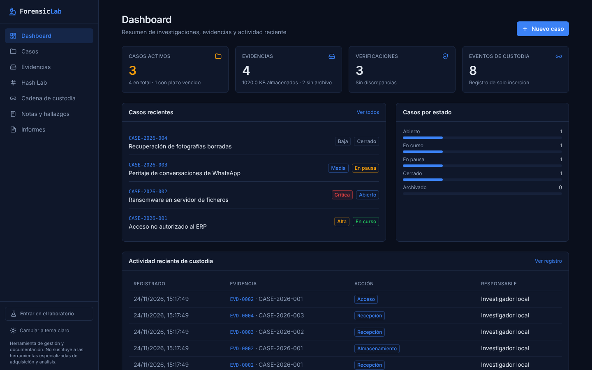

> ForensicLab es una herramienta de **gestión y documentación**. No adquiere ni analiza evidencias: eso se hace con herramientas especializadas (FTK Imager, Autopsy, Volatility…). ForensicLab organiza todo lo que ocurre alrededor y ayuda a demostrar **cómo** se obtuvo y trató cada evidencia.

---

## Índice

- [Índice](#índice)
- [Qué problema resuelve](#qué-problema-resuelve)
- [Funcionalidades](#funcionalidades)
  - [Casos](#casos)
  - [Evidencias y cadena de custodia](#evidencias-y-cadena-de-custodia)
  - [Hashes e integridad](#hashes-e-integridad)
  - [Guía de trabajo por fases](#guía-de-trabajo-por-fases)
  - [Informes](#informes)
  - [Modo laboratorio](#modo-laboratorio)
  - [Write-ups](#write-ups)
  - [Tema claro y oscuro](#tema-claro-y-oscuro)
- [Garantías forenses](#garantías-forenses)
- [Decisiones técnicas](#decisiones-técnicas)
- [Tecnologías](#tecnologías)
- [Estructura del proyecto](#estructura-del-proyecto)
- [Limitaciones y próximos pasos](#limitaciones-y-próximos-pasos)

---

## Qué problema resuelve

En una investigación forense no basta con encontrar algo: hay que poder demostrar que la evidencia **no se ha alterado**, **quién la ha tenido** en cada momento y **qué pasos se siguieron**. Esa documentación suele acabar repartida entre hojas de cálculo, actas en papel y notas sueltas.

ForensicLab la reúne en un solo sitio y la protege:

- Los registros críticos (cadena de custodia, hashes, historiales) **no se pueden modificar ni borrar**, ni siquiera por un error del propio código.
- Una **guía de trabajo por fases** indica qué falta por hacer en cada caso y en cada evidencia.
- Todo queda listo para redactar el **informe final**.

---

## Funcionalidades

### Casos

Cada caso recoge la información que se suele pedir en un peritaje: tipo de caso, confidencialidad, responsable, plazos, solicitante, **fundamento y autorización** de la investigación (orden judicial, encargo, consentimiento…), fecha y lugar de los hechos, alcance y conclusiones. La referencia (`CASE-2026-001`) la asigna el sistema y no se puede cambiar.

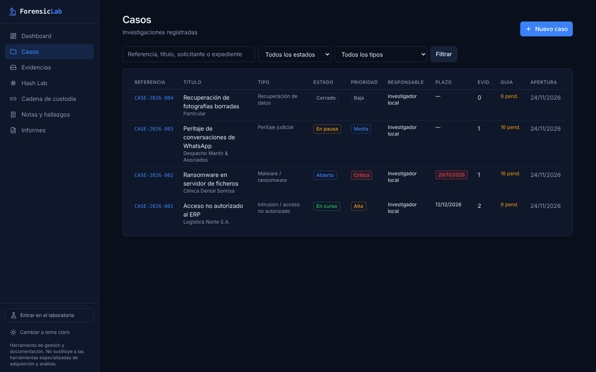

El listado permite filtrar por estado y tipo, y buscar por referencia, título, solicitante o expediente. Marca en rojo los plazos vencidos y muestra cuántos pasos obligatorios quedan pendientes en cada caso.

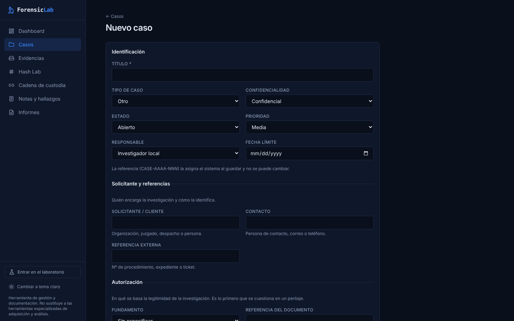

La ficha del caso reúne los datos generales, la autorización, los hechos y el alcance. Arriba, un **semáforo** indica si quedan pasos obligatorios pendientes.

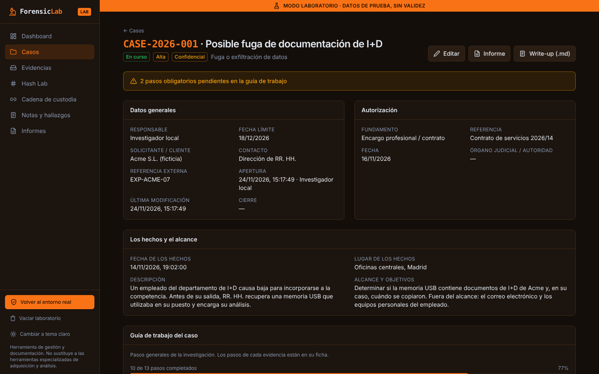

Un caso se puede editar, pero **cada cambio queda registrado** con su valor anterior, el nuevo, el usuario y la fecha:

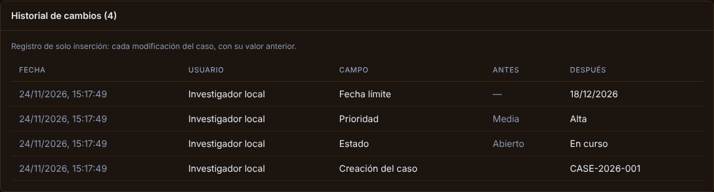

### Evidencias y cadena de custodia

Cada evidencia (dispositivo, imagen de disco, volcado de memoria, captura de red, archivo…) se registra con sus metadatos: fabricante, modelo, número de serie, zona horaria del origen y método de adquisición. **No puede existir sin el primer eslabón de su cadena de custodia**, que se registra en el mismo momento.

La cadena de custodia es un registro cronológico de **solo inserción**. Los errores no se borran: se corrigen con un evento de *corrección* que apunta al original, y ambos se conservan. Se distingue entre **cuándo ocurrió** un hecho y **cuándo se registró** en el sistema.

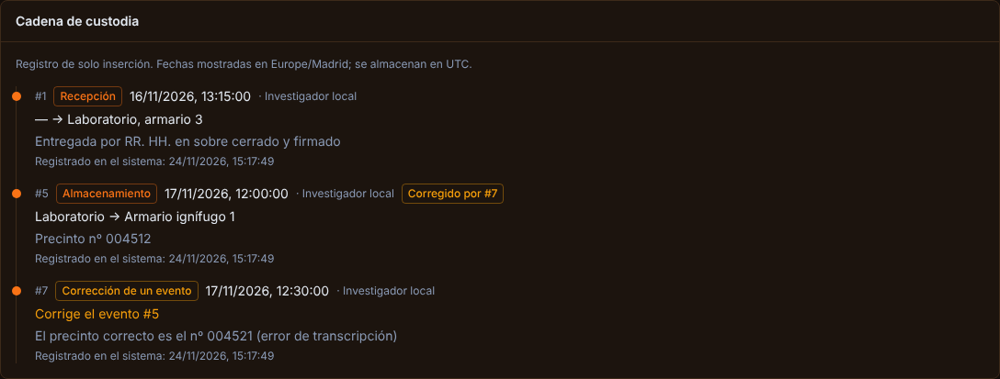

### Hashes e integridad

Al incorporar el archivo de una evidencia, ForensicLab:

1. Lo copia a un **almacén privado** fuera de la carpeta pública, con un nombre interno y en solo lectura.
2. Calcula **MD5, SHA-1 y SHA-256 mientras lo recibe**, sin cargarlo entero en memoria (funciona igual con imágenes de cientos de GB).
3. Lo **compara automáticamente** con los hashes del acta de adquisición, si se registraron antes.

Cada hash indica su **origen**: calculado por ForensicLab o importado de otra herramienta. El botón «Verificar integridad» recalcula los hashes y registra cada comparación. La base de datos comprueba que un resultado «Coincide» sea real.

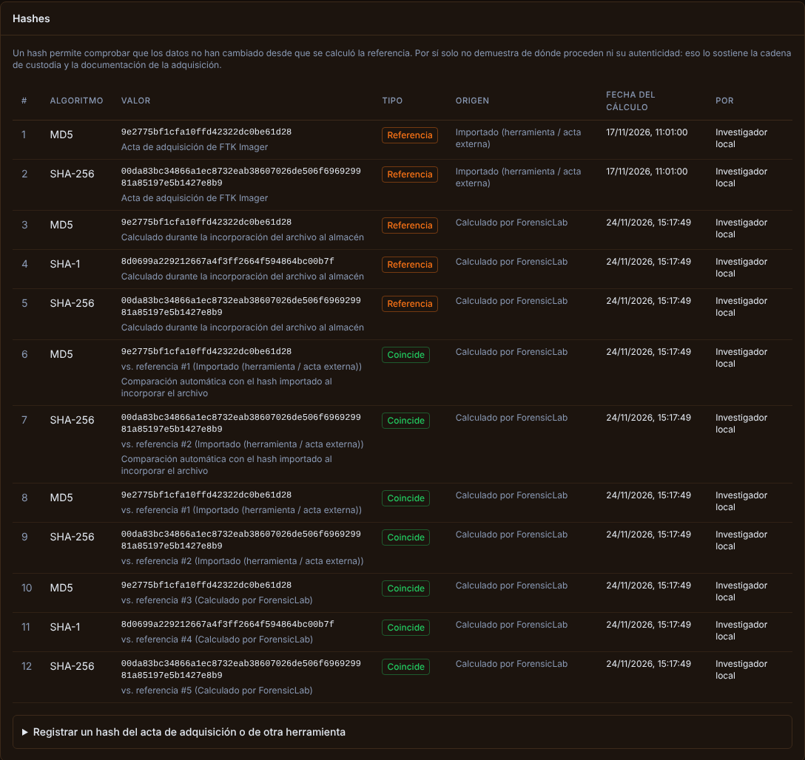

El **Hash Lab** calcula y compara hashes de cualquier archivo o texto sin guardar nada, y detecta el algoritmo por la longitud del valor esperado:

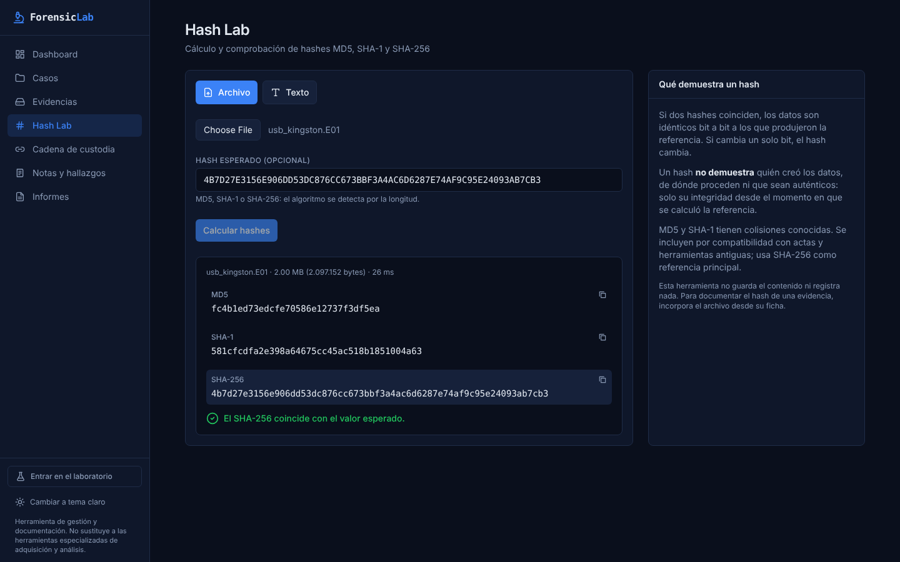

> Un hash demuestra que los datos **no han cambiado** desde que se calculó la referencia. No demuestra por sí solo su procedencia ni su autenticidad: eso lo sostienen la cadena de custodia y la documentación de la adquisición.

### Guía de trabajo por fases

Cada caso y cada evidencia tienen una lista de pasos agrupados por fases (**preparación, identificación, adquisición, preservación, análisis y documentación**). Los pasos se basan en:

- **ISO/IEC 27037**: identificación, recogida, adquisición y preservación de evidencia digital.
- **UNE 71506**: metodología para el análisis forense de evidencias electrónicas.
- **UNE 197010**: elaboración de informes periciales TIC.
- **RFC 3227**: recogida de evidencias y orden de volatilidad.

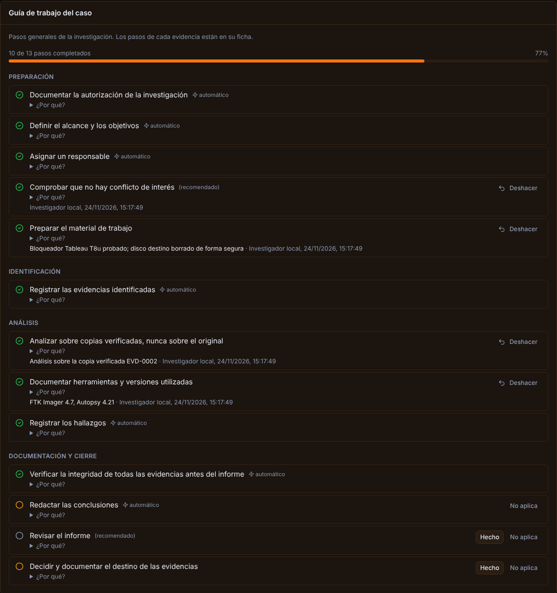

- Los pasos **automáticos** se marcan solos a partir de los datos (por ejemplo, «Documentar la autorización» al rellenar el fundamento).
- Los **manuales** se marcan como hechos, con una nota opcional (modelo del bloqueador, número de precinto…).
- Cualquier paso puede marcarse como **«No aplica»**, pero hay que explicar el motivo.
- Cada paso explica **por qué importa** y de qué norma procede.

Los pasos de cada evidencia dependen de su tipo: un disco duro incluye el bloqueador de escritura; un móvil, el aislamiento de la red; un equipo encendido, la captura de la memoria RAM.

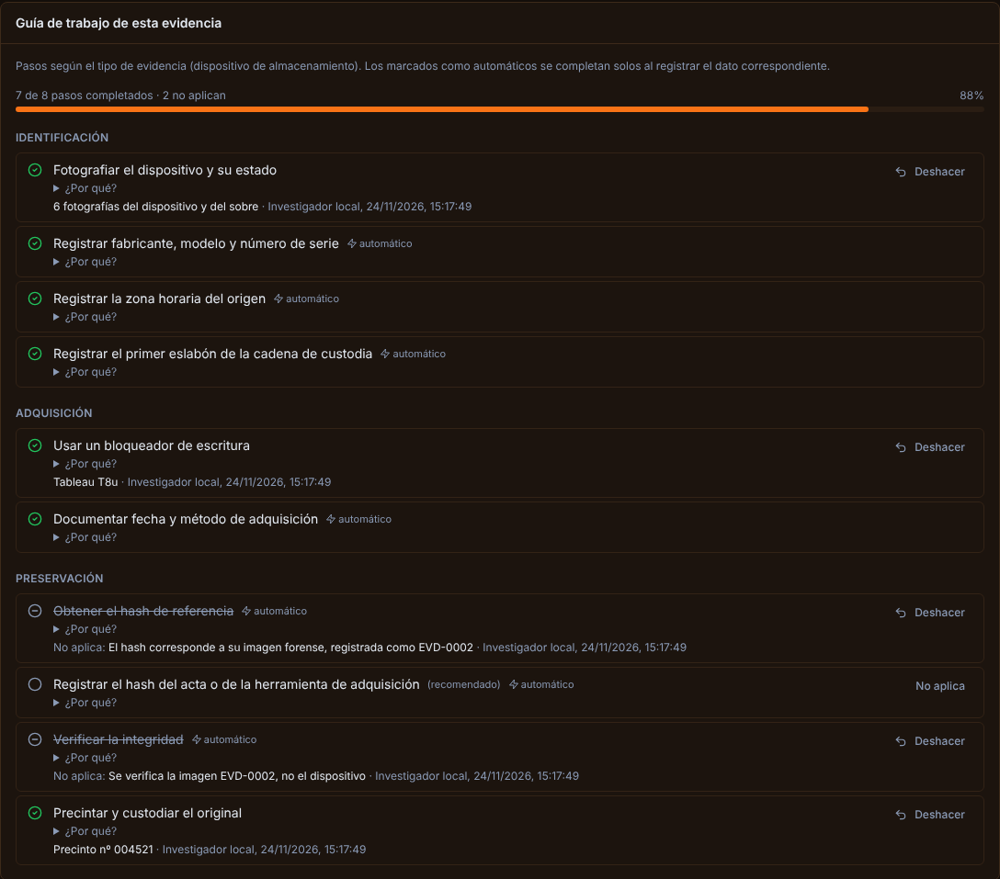

Al **cerrar un caso** con pasos obligatorios pendientes, la aplicación muestra la lista y pide confirmación. Si se cierra igualmente, queda constancia en el historial.

### Informes

El informe del caso reúne la autorización, el objeto y alcance, cada evidencia con sus hashes y su cadena de custodia, las notas, el estado de la guía (incluidos los pasos que no aplicaban y su motivo) y las conclusiones. Se exporta a **PDF** desde el navegador, en blanco y negro y sin la interfaz.

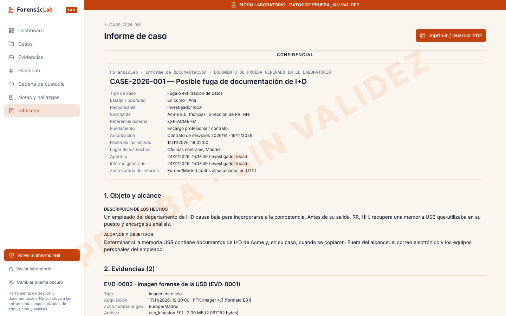

### Modo laboratorio

Un interruptor cambia toda la aplicación a un **entorno de pruebas** con su propia base de datos y su propio almacén. Sirve para practicar sin mezclar nada con los casos reales.

- Se reconoce de inmediato: la interfaz pasa a **tonos naranjas** y aparece una franja fija superior.
- Los informes generados en el laboratorio llevan la marca de agua **«PRUEBA · SIN VALIDEZ»**.
- El laboratorio se puede **vaciar** por completo; el entorno real no se puede borrar.
- Si una pestaña se quedó abierta en el otro entorno, cualquier escritura desde ella se **rechaza**.

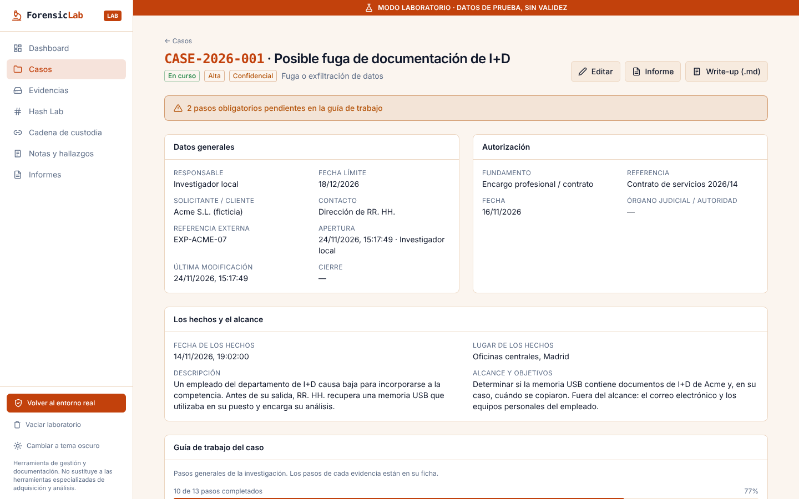

### Write-ups

En el laboratorio, un caso de práctica se puede convertir en un **artículo en Markdown** para publicarlo, por ejemplo en un portfolio. Incluye escenario, evidencias, metodología seguida, hashes, cadena de custodia, hallazgos, conclusiones y lecciones aprendidas, con cabecera para Astro. Se edita en la propia aplicación y se descarga o se exporta directamente a la carpeta de posts de la web.

Por confidencialidad, esta función **no existe en el entorno real**.

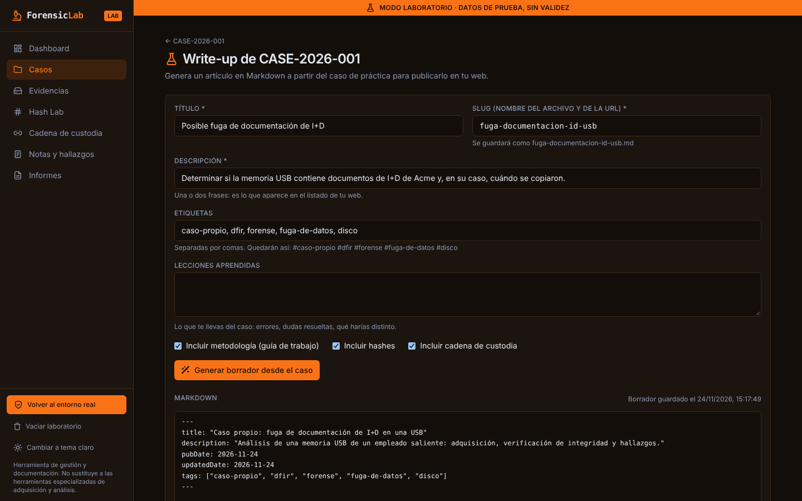

### Tema claro y oscuro

La interfaz tiene tema oscuro (azul) y claro, y sigue por defecto la preferencia del sistema operativo.

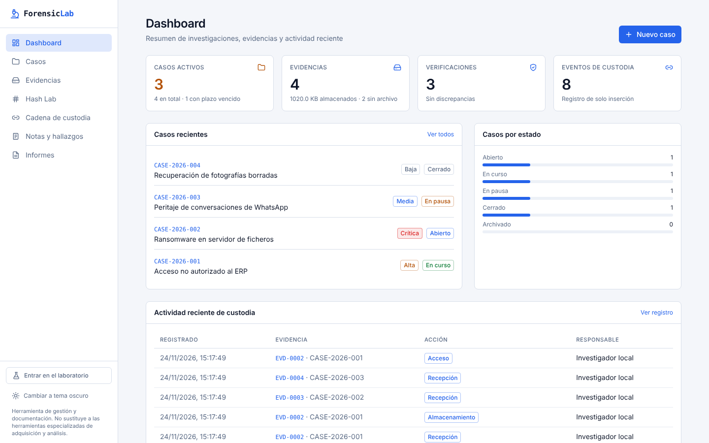

---

## Garantías forenses

| Requisito | Cómo se cumple |
|---|---|
| Custodia no modificable | Triggers SQL bloquean `UPDATE` y `DELETE` en `custody_events`; los errores se corrigen con un evento nuevo |
| Hashes fiables | la tabla `hash_records` es de solo inserción; la base de datos comprueba que un «Coincide» es real |
| Calcular ≠ acreditar | Cada hash indica si lo calculó ForensicLab o se importó de un acta o herramienta |
| Quién y cuándo | Usuario y fecha en todas las operaciones; historial de cambios de casos y evidencias |
| Fechas sin ambigüedad | Se guardan en UTC (ISO 8601) y se muestran en la zona configurada; zona horaria del origen de cada evidencia |
| Original intacto | Almacén privado fuera de `public/`, nombre interno, solo lectura; un archivo incorporado no se puede sustituir |
| Sin borrados accidentales | Claves foráneas `ON DELETE RESTRICT` en todas las relaciones |
| Pasos justificados | La guía exige un motivo para cada «No aplica» y registra quién decidió cada paso |

---

## Decisiones técnicas

**SQLite en lugar de un servidor de base de datos.** Es un único archivo, no requiere instalar ni configurar nada y se copia fácilmente. Es suficiente para un uso individual o de un equipo pequeño. En modo WAL admite lecturas simultáneas con un único escritor. Si en el futuro hiciera falta escritura concurrente intensiva o varias instancias, la arquitectura permite migrar a PostgreSQL.

**SQL escrito a mano, sin ORM.** Las restricciones forenses (triggers de solo inserción, comprobaciones de coherencia de hashes, `CHECK` de formatos) se expresan directamente en SQL y se aplican **en la base de datos**, no solo en el código.

**Integridad en la base de datos, no solo en la aplicación.** Aunque el código tuviera un error, la base de datos seguiría rechazando la modificación de la custodia o un resultado de verificación falso.

**Hashes por streaming.** El archivo se procesa por bloques: se escribe en disco y se calculan los tres algoritmos en una sola lectura, sin cargarlo en memoria.

**Fechas en UTC.** Se almacenan siempre en UTC y se convierten solo al mostrarlas, lo que evita ambigüedades con los cambios de horario.

**Validación en el servidor.** Todo lo que llega a la API se valida (tipo, obligatoriedad, longitud, valores permitidos, formato de fechas y hashes) antes de llegar al SQL.

---

## Tecnologías

- **Next.js 16** (App Router), **React 19** y **TypeScript**
- **Tailwind CSS 4** e iconos **Lucide**
- **SQLite** mediante **better-sqlite3**
- **Node.js** (`crypto`, `stream`) para el cálculo de hashes y el almacén de evidencias

---

## Estructura del proyecto

```text
app/                    Páginas y rutas API (App Router)
  api/                  Route Handlers: validan, llaman a lib/ y responden JSON
components/             Componentes de interfaz y formularios
lib/
  db/                   Conexión, migraciones y esquema SQL
  repositories/         Todo el SQL de la aplicación
  services/             Operaciones de varios pasos (archivo + base de datos)
  storage/              Almacén privado de evidencias
  forensic/             Cálculo de hashes por streaming
  workflow/             Definición y evaluación de la guía de trabajo
  writeups/             Generación de write-ups en Markdown
  auth/                 Usuario actual (punto de entrada de la autenticación)
  environment.ts        Entorno real / laboratorio
  validation.ts         Validación de datos de entrada
data/  storage/         Datos locales (excluidos de Git)
```

---

## Limitaciones y próximos pasos

ForensicLab está pensada para usarse **en local, por una sola persona**. Antes de desplegarla en un servidor harían falta:

- **Autenticación, usuarios y roles.**
- **HTTPS** delante de la aplicación.
- **Copias de seguridad** automáticas de la base de datos y del almacén.

Funcionalidades previstas:

- **Hallazgos vinculados a evidencias**: ruta, artefacto, herramienta y fecha del artefacto.
- **Línea temporal** construida a partir de hallazgos y eventos de custodia.
- **Anexos**: fotografías y documentos de trabajo que no son evidencias.
- **Importación** de los informes de FTK Imager y otras herramientas.
- **Borrador del informe final en Word** con plantilla propia (estructura UNE 197010).

---

*Las capturas muestran datos ficticios creados para la demostración; el caso de la ficha, la guía, el informe y el write-up está en el modo laboratorio.*
